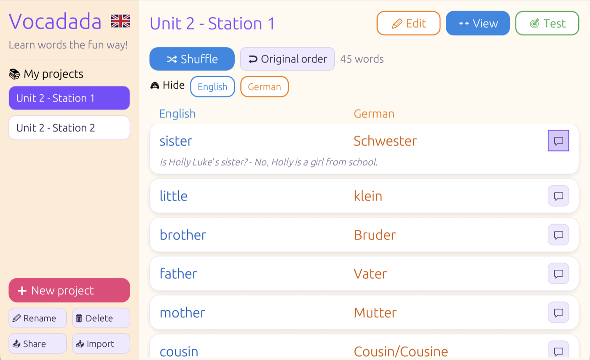
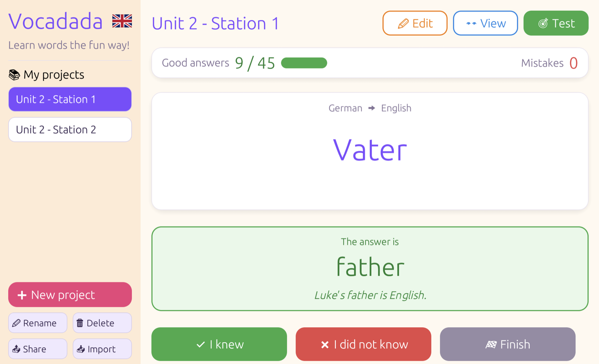
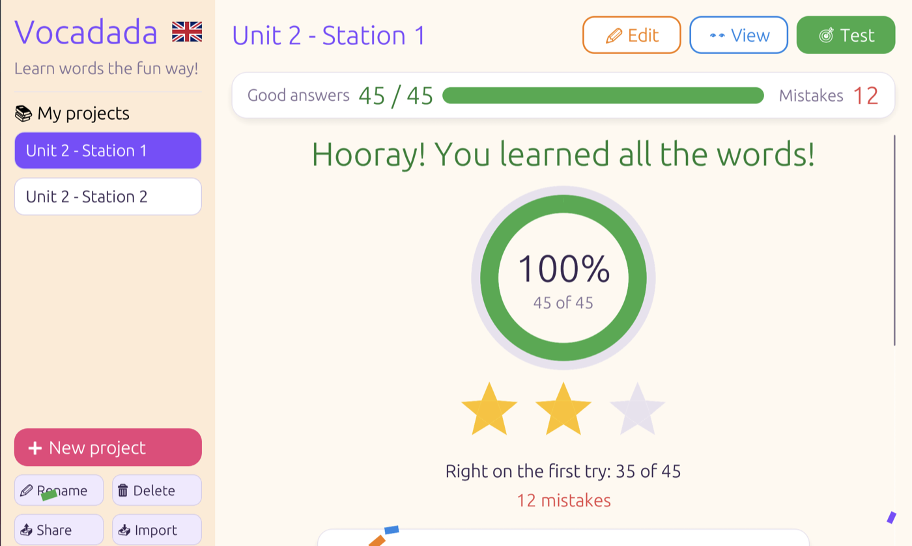

# Vocadada

A small, playful vocabulary trainer. Make a project with word pairs in two languages, look through them, then test yourself in either direction. The test counts good answers and mistakes and gives stars at the end.

Built with Rust and [egui](https://github.com/emilk/egui). It runs as a desktop app or in the browser, where it can be installed as an app (PWA) on phones and tablets.

<p>
  <a href="docs/screenshots/view.png"></a>
  <a href="docs/screenshots/test.png"></a>
  <a href="docs/screenshots/results.png"></a>
</p>

## Try it online

**▶ [Open Vocadada in your browser](https://bwalter.github.io/vocadada/)**: no installation or account needed.

> [!NOTE]
> Your words stay on your device. They are saved only in your browser's local storage, never sent to a server. To move a project to another device, use **Share** and **Import**.

## Requirements

- Rust (stable) via [rustup](https://rustup.rs)
- For the web version only:
  ```sh
  rustup target add wasm32-unknown-unknown
  cargo install --locked trunk   # or: brew install trunk
  ```

## Native (desktop)

```sh
cargo run --release
```

The binary ends up in `target/release/vocadada`. Projects are saved in the system data folder, e.g. `~/Library/Application Support/vocadada/projects.json` on macOS.

## Web

```sh
trunk serve --release
```

Then open http://127.0.0.1:8080. Projects are saved in the browser's local storage.

To try it on a phone on the same network, run `trunk serve --release --address 0.0.0.0` and open `http://<your-computer-ip>:8080`.

## Publish the web version

```sh
trunk build --release
```

This creates a `dist/` folder with everything needed. Upload its contents to any static web host.

If the app is served from a subfolder instead of the domain root (e.g. `https://example.com/vocadada/`), pass the path:

```sh
trunk build --release --public-url /vocadada/
```

The site must be served over HTTPS for "Add to Home Screen" and offline use to work.
